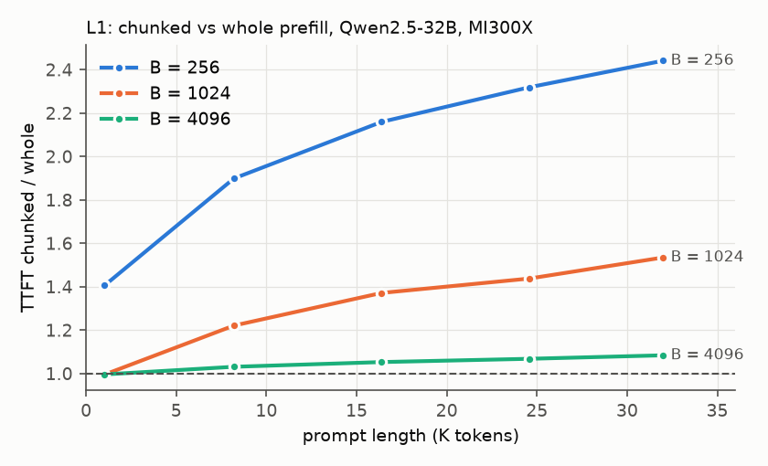
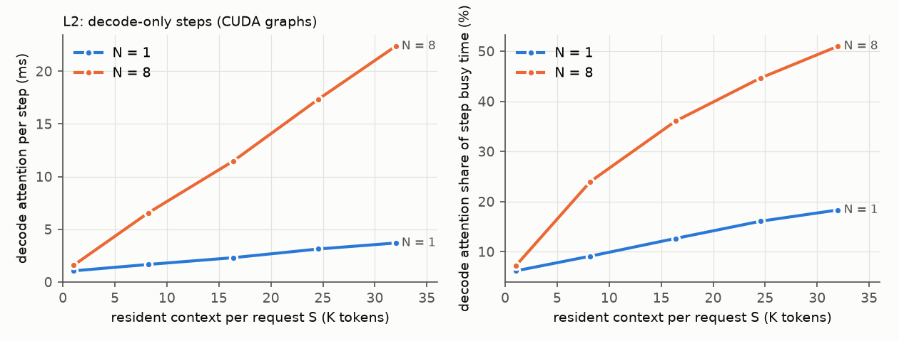
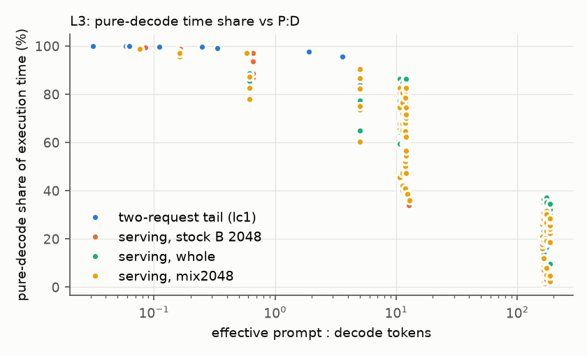
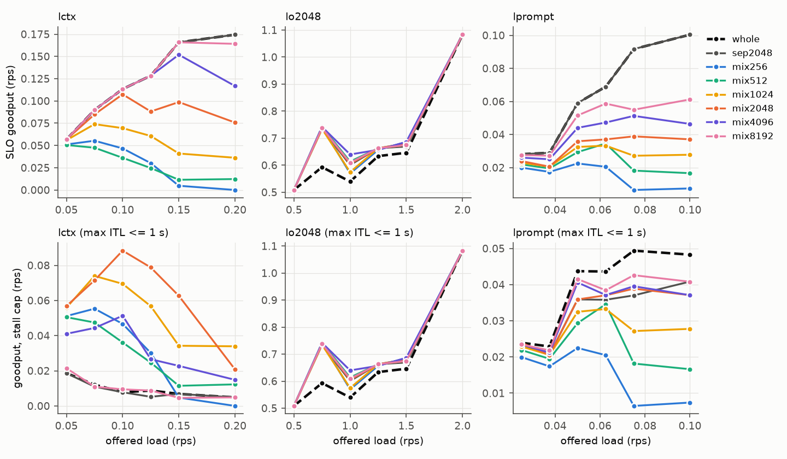
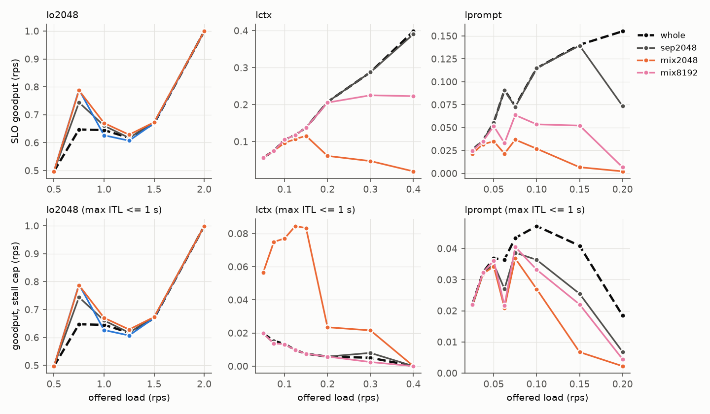
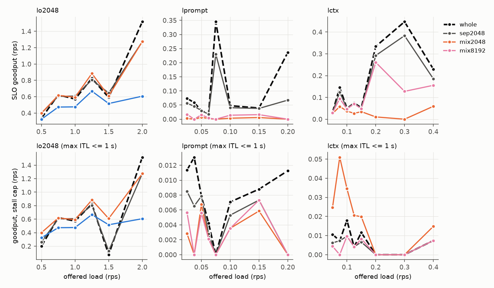
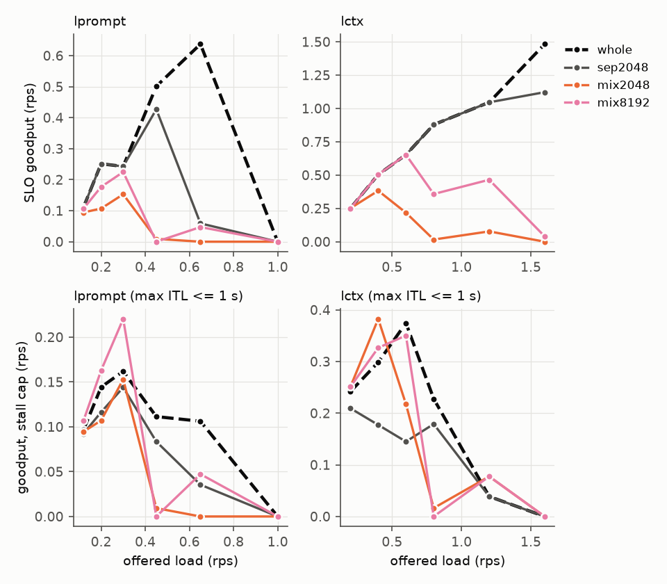

# Long-context and long-output chunked prefill on MI300X — results

Status: **FINAL** (lc1, lc2, lc3 and the lc3fx re-runs in). Design and pre-registration:
`docs/amd/lc_campaign_design_20261124.md` (amendments 1–4). Handoff: `docs/amd/long_context_chunked_prefill_20261124.md`. Baseline: the November 18 campaign.

All numbers unless labelled "7B": Qwen2.5-32B, BF16, one MI300X per lane (TP1), vLLM 0.23.0 V1 in process, ROCM_ATTN, CUDA graphs
FULL_AND_PIECEWISE ≤ 512 tokens unless "eager". 256 KiB of KV per token, 64 GB of weights. Clocks are not controlled.
Medians, with paired bootstrap 95% CIs where stated. Sources: `results_published/amd_20261124_mi300x_lc_lc1/lc_tables.json`
(job 547842), `results_published/amd_20261125_mi300x_lc_lc2/lc_tables.json` (job 548920),
`results_published/amd_20261125_mi300x_lc_lc3/{lc_tables,lc_tables_q7,lc_decisions}.json` (job 555664) and
`results_published/amd_20261126_mi300x_lc_lc3fx/lc_tables.json` (job 558807, amendment 4 re-runs).

Measured ranges: prompts 128–32 000 tokens (the 32B and 7B position limit is 32 768), outputs 1–4 096 tokens, decode
width 1 / 8 / 32, resident context per request 1 K–32 K tokens, serving P:D 0.08–175, offered load 0.025–3 rps. GPUs:
MI300X only (mi3008x, 8 lanes × 1 GPU per job; smoke on mi3001x). Second model: Qwen2.5-7B (L1, L2, L3A, serving).

## 0. Answers in one paragraph each

1. **Chunking cost vs a whole prompt.** At 32 000 tokens, chunking costs 1.08× (B 4096), 1.54× (B 1024) and 2.44×
   (B 256) the whole-prompt time. The penalty grows with length at every budget, and at 1 024 tokens one chunk is free
   (0.996×). The cost is not extra arithmetic: MFMA instruction counts are within 2–3% of whole. It is not added reads
   either. The c·k(k−1)/2 prefix revisit is 133 GB at B 1024 (≈ 33 ms at the measured 4.1 TB/s), against a 3.8 s penalty,
   and the measured pre-MALL request-side reads are *lower* at B 1024 (5.0 TB) than whole (10.5 TB). The penalty is
   kernel efficiency. The prefill-attention kernel over a paged prefix takes 1.93× (B 1024) and 3.55× (B 256) the
   whole-prompt attention time, and the smaller-M GEMMs take 1.16× and 1.52× the linear time.
2. **Decode attention vs resident context.** Decode attention per step is linear in resident tokens N·S:
   0.95 ms + 82.5 µs per 1 K resident tokens (R² = 0.9997, 30 cells, N = 1 / 8 / 32, S = 1 K–32 K). That is 3.1 TB/s of
   KV, 75% of the measured streaming reference. Its share of a pure-decode step rises from 7% (N 8, S 1 K) to 51%
   (N 8, S 32 K). In a mixed step, the chunk's prefill attention does not depend on the decoders' S (60–62 ms at
   P 4096 + C 1024 for N = 8 at every S). The linear-layer time is shared and set by total tokens.
3. **Pure-decode fraction as outputs lengthen.** With a 128-token prompt, ≥ 99.6% of iterations and ≥ 99.6% of
   execution time are pure decode at O = 512, rising with O. A single 8 192-token injection drops the execution share to
   78–88% at O = 512 and 93–98% at O = 4 096. The spread depends on policy, and B 256 is lowest because its chunks run
   longest. Under stock serving, the pure-decode time share falls from ≈ 100% at P:D < 0.3 to 34–82% at P:D ≈ 12 and
   1–30% at P:D ≈ 170 (long prompts), depending on load.
4. **Memory-service sensitivity of the remaining steps.** A disjoint-CU streaming competitor drawing 1.88 TB/s slows
   pure-decode steps by 16–20% and mixed steps by 18–23%. At 0.95 TB/s the slowdown is 5–9%, and a compute-only
   competitor gives 1–5%. The slowdown does not grow with S. On this platform the memory competitor also lowers the
   decoder's clocks (median SCLK −12…−16%, MCLK −9%, board power ≈ 740 W). The slowdown is therefore an upper bound on
   the bandwidth-sharing effect. Bytes: FETCH_SIZE / WRITE_SIZE (KiB) and TCC_EA0_RDREQ_DRAM (128-byte requests) count
   L2→fabric requests, upstream of the 256 MB MALL. No counter on this stack measures HBM bytes (section 4.3).
5. **Where tuned chunking helps or hurts serving** (held-out seeds 201–203, budgets chosen on development seeds,
   section 5). With short prompts and long outputs, chunking wins. lo2048 (P:D 0.2): mix256 sustains 0.75 rps vs 0.5
   for whole and sep2048 under both SLOs. On development, lo512 (P:D 0.6) gives 3.0 vs 2.0. Around P:D 5 the policies
   tie within one step. With long prompts, the answer depends on the SLO:
   - Under the primary SLO (p95 ITL), whole or separate prefill wins. lctx (P:D 11): 0.3 vs 0.2 rps for mix8192.
     lprompt (P:D 175): 0.15 vs 0.0375.
   - With a 1 s cap on each request's worst gap, whole and separate prefill fail at the lowest rate, because one
     prompt stalls co-running decoders for 3–28 s. On lctx only a small budget (mix2048, 0.075 rps) is feasible. On
     lprompt no policy is feasible.
   - On 7B (one seed), the primary-SLO sign repeats (separate 2–5× higher). Under the stall cap only mix8192 is
     feasible on lprompt; lctx ties.

   Chunking trades worst-case gaps for throughput and per-request p95 ITL. The boundary in P:D lies between 0.6 and 5
   for throughput, but no P:D boundary exists for worst-case stalls.

## 1. Platform, controls and failed cases

| item | value |
|---|---|
| node | mi3008x k002-002 (lc1, job 547842, release c0f3e871), 8 lanes × 1 GPU |
| software | vLLM 0.23.0, ROCm 7.14.1 container, torch 2.11, rocprofv3 1.0.0 (ROCm 7.1.0), CP firmware 177 |
| clocks | not changed; per-run medians recorded. lc1 lanes 1366–1606 MHz SCLK during timing |
| anchor (L0) | step anchor **fails** the 5% rule: t_ref 27.1 ms vs 30.9 ms in s1, at SCLK 1440 vs 1131 MHz. Serving anchor passes (96.0% of steps / 89.6% of exec pure decode, rule 95.5–96 / 87.9–89.5) |
| cross-lane control | identical work on two lanes (L1, L = 1024, one chunk): ratio 0.996 [0.992, 1.001] |

Failed acquisitions (kept, raw under the run root):
- `lc1_pmc_mix1024_SQ_INSTS_VALU_MFMA_MOPS_BF16` attempt 1: rocprofv3 queue error (malformed AQL packet). Attempt 2
  completed.
- `lc4_pmc_{WRITE_SIZE, TCC_EA0_RDREQ_DRAM_sum}` attempt 1: execution failures. Attempt 2 of each completed.
- `lc4_pmc_FETCH_SIZE`: illegal memory access in the S = 32 000, N = 8 cell on both attempts. Re-run in lc2 (amendment 2).
- `lc4_counter_audit`: exit 0, but 0 / 208 runs saw a device (launcher bug, fixed). Re-run in lc2.
- lc2: 8 serving steps (`lc5d_*`) hit `hipErrorLaunchFailure` on attempt 1 and completed on attempt 2; kept. Both
  re-runs (FETCH_SIZE S 32 000 N 8 split out; counter audit) completed.
- lc3: 8 lctx separate-policy steps (`lc5h_lctx_{whole,sep2048}_s20{1,2,3}`, `lc5b_lctx_{whole,sep2048}_s201`)
  aborted on both attempts with `hidden waiting queue received requests`. At the extended rates (≥ 0.3 rps), vLLM
  preempts a running request under KV pressure during a decode-only step and prepends it to the waiting queue, which
  the separate-policy wrapper had hidden. Fixed in `cp_sched.py` (the preempted request is carried to the front of
  the restored queue, as stock vLLM does). The fix only acts where the old code aborted. All 8 were re-run as
  `<step>_fx` in lc3fx (job 558807, 8 / 8 completed, amendment 4). The failed partial traces are kept and not used.
- Smoke 547179 (harness id-suffix bug), kept. The smoke anchor ran on a faster-clocked node (amendment 1).

## 2. L1 — chunked vs whole prefill

TTFT ratio chunked / whole (same prompt token ids, 8 paired reps, first sampled token identical in 120 / 120 pairs):

| L | B 4096 | B 1024 | B 256 | whole TTFT |
|---|---|---|---|---|
| 1 024 | 0.996 | 0.996 | 1.406 | 0.146 s |
| 8 192 | 1.031 | 1.221 | 1.899 | 1.23 s |
| 16 384 | 1.053 | 1.371 | 2.159 | 2.87 s |
| 24 576 | 1.068 | 1.438 | 2.319 | 4.91 s |
| 32 000 | 1.084 | 1.535 | 2.441 | 7.04 s |

Kernel time at L = 32 000 (rocprofv3 kernel trace, ms):

| arm | linear | prefill attn | other | busy | host gaps |
|---|---|---|---|---|---|
| whole | 3 503 | 3 166 | 196 | 6 892 | 5 |
| B 4096 | 3 690 | 3 686 | 195 | 7 605 | 39 |
| B 1024 | 4 071 | 6 112 | 234 | 10 475 | 164 |
| B 256 | 5 333 | 11 238 | 350 | 17 060 | 503 |

Counters at L = 32 000 (separate eager passes, one counter each):

| arm | MFMA PFLOP | FETCH_SIZE | TCC_EA0_RDREQ_DRAM × 128 B | WRITE_SIZE |
|---|---|---|---|---|
| whole | 2.67 | 10.5 TB | 10.5 TB | 0.60 TB |
| B 1024 | 2.74 | 5.0 TB | 5.0 TB | 0.63 TB |
| B 256 | 2.76 | 12.1 TB | 12.1 TB | 0.68 TB |

Supported:
- Chunking costs time, not FLOPs. The extra time grows with L and with smaller B.
- The c·k(k−1)/2 revisit model predicts the *shape* (attention time grows ≈ quadratically in the number of chunks), but
  through attention kernel efficiency, not bytes. Its byte term (0.13 TB at B 1024, 0.52 TB at B 256) is under 5% of the
  measured request-side reads.

Strongest counterexample: request-side reads are not monotone in B. They are lowest at B 1024 and highest at B 256 and
whole, so "chunking adds memory traffic" is false at the L2→fabric observation point. The whole prompt's 32 000-row
GEMMs re-fetch weight tiles per M-tile.

Gap: whether HBM bytes (after MALL) follow the same order is unmeasured. Other attention kernels (CK / FA) may change
the 1.9× attention penalty.

## 3. L2 — decode attention vs prefill attention vs shared linear

Pure-decode steps (graphs, kernel trace):

| N | S | step busy | decode attn | share | linear |
|---|---|---|---|---|---|
| 1 | 1 K → 32 K | 17.0 → 20.2 ms | 1.1 → 3.7 ms | 6% → 18% | 14.2 → 14.7 ms |
| 8 | 1 K → 32 K | 21.9 → 43.9 ms | 1.6 → 22.4 ms | 7% → 51% | 18.4 → 19.3 ms |
| 32 | 1 K, 8 K | 26.0, 49.2 ms (timed) | — | — | — |

Fit over 30 profiled cells: decode attention (ms) = 0.949 + 8.25 × 10⁻⁵ × N·S, R² = 0.9997 (H2a supported).

Mixed steps, N decoders + one C-token chunk after a cached P-token prefix:
- **H2b supported.** The chunk's prefill attention is independent of the decoders' S: 27.6–28.7 ms (C 256) and
  59.7–62.5 ms (C 1024) for N = 8 over S = 1 K–32 K. It grows with the prefix P (anchors: C 1024 alone takes 161 / 224 /
  359 / 506 ms at P = 0 / 4 K / 16 K / 28 K).
- **Counterexample (implementation).** With N = 1 the same chunk's prefill attention is 83–88 ms, against 60 ms alone
  or with 8 decoders, at every S. The kernel's launch depends on the batch composition, not on S. This explains the
  smoke "85 vs 61 ms" observation.
- **H2c partly supported.** The hybrid saving (separate − mixed) / separate is 12–15% at C 1024, N = 8, and 22–27% at
  C 256, flat in S (no shrink). It shrinks with prefix P: 3.6% at P = 16 K and 28 K. One shared weight pass is worth
  ≈ 20–30 ms against a long-prefix chunk of 360–500 ms.

Gap: N = 32 at S ≥ 16 K exceeds the 300 K-token per-step limit and the KV pool. Wider batches at long S need TP > 1.

## 4. L3 part A — the pure-decode tail; L4 — memory service

### 4.1 Two-request tails (A: 128-token prompt, O outputs; B: I-token prompt, 256 outputs, injected after A's first token)

| O | I | decode share of steps | of exec | A max ITL after inject | B TTFT |
|---|---|---|---|---|---|
| 512 | 0 | 99.8% | 99.6% | — | — |
| 4 096 | 0 | 99.98% | 99.95% | — | — |
| 512 | 8 192 | 93.4–99.6% | 77.9 (B 256) – 88.1% (whole) | 99 (B 256) – 1 358 ms (sep 2048) | 1.23 (whole) – 2.46 s (B 256) |
| 4 096 | 8 192 | 99.2–99.95% | 96.7–98.3% | same | same |

### 4.2 Competition (decoder on CUs 0–255, owned competitor on 256–303, two blocks, eager)

| treatment | competitor | pure decode (ref) | mixed C 1024 |
|---|---|---|---|
| arith100 | compute only | 1.01–1.05 | 0.99–1.08 |
| mem50 | 0.95 TB/s | 1.05–1.09 | 1.01–1.09 |
| mem100 | 1.88 TB/s | 1.16–1.20 | 1.18–1.23 |

The slowdown is flat in S (1 K, 16 K, 32 K) and about the same for pure-decode and mixed steps (H4a not supported as
stated). Telemetry during mem100: decoder-run median SCLK 1305 / 1510 MHz vs 1547 / 1716 absent; "memory clock"
1141 / 1160 vs 1251 / 1281 MHz; power 739–747 W vs 618–639 W. The competitor's effect therefore includes a
power-managed clock reduction that a bandwidth-only model does not have.

### 4.3 Where each counter measures bytes

| counter | unit | observation point | evidence |
|---|---|---|---|
| FETCH_SIZE | KiB | TCC (L2) → EA read requests, before MALL / Infinity Cache | lc2 audit: 1.000× useful bytes for 1 GiB and 4 GiB streaming reads, **0.999× for a 128 MiB MALL-resident read** (not filtered by MALL), 0.004× for an 8 MiB L2-resident read. Long-context re-run, pure decode: 1.00× (N 1, S 1 K) to 1.05× (N 8, S 32 K) of logical bytes |
| WRITE_SIZE | KiB | L2 → EA write requests | lc2 audit: 1.000× for a 4 GiB streaming write |
| TCC_EA0_RDREQ(_DRAM), TCC_MISS | 128-byte requests | L2 misses / EA reads, before MALL | lc2 audit: 1.000× streaming, 0.999× MALL-resident |
| TCC_EA0_WRREQ(_64B, _DRAM) | 64-byte requests | L2 → EA writes | lc2 audit: 1.000× for a 4 GiB write (0.5 per 32 B) |
| TCC_EA0_RDREQ_DRAM_sum | 128-byte requests (lc1 fit) | L2 → EA reads tagged DRAM-bound, before MALL | × 128 B = 1.00 / 1.04 / 1.05 × logical bytes for pure decode at N·S = 1 K / 131 K / 256 K |
| SQ_INSTS_VALU_MFMA_MOPS_BF16 | × 512 FLOP | issued MFMA | L1 whole matches analytic linear + attention FLOPs within 4% |
| HBM bytes | — | **not observable** on this stack (no DF / HBM counters exposed by rocprofv3 here) | — |

Every read counter that passes the streaming test also counts the MALL-resident read at full size, so the audit finds
**no post-MALL (HBM-side) counter**; 11 candidates tested, 2 reps each. A mixed step with a 1 024-token chunk fetches
2.3× its logical bytes (C 1024, N 1 / 8, all S: e.g. 153.7 vs 65.6 GB, 191.9 vs 99.7 GB), while the same decoders
alone fetch 1.00–1.05×. The excess is chunk activation traffic at the request side, and whether it reaches HBM is not
observable.

## 5. L3 part B and L5 — serving under matched arrivals

SLO and λ\*: amendment 2 table. Primary SLO: TTFT ≤ 5 × pilot p90 and per-request p95 ITL ≤ 5 × pilot median.
Secondary (amendment 3) adds each request's **maximum** ITL ≤ 1 000 ms. Sustained rate = highest rate with attainment
≥ 0.9 and nothing incomplete at it and every lower rate.

### 5.1 Development (lc2, seeds 101 / 102, Poisson): sustained rate under the primary SLO

| workload (P:D) | whole | sep2048 | mix256 | mix512 | mix1024 | mix2048 | mix4096 | mix8192 |
|---|---|---|---|---|---|---|---|---|
| lo2048 (0.15) | 0.75 / 0.5 | 0.75 / 0.75 | 0.75 / 0.75 | 0.75 / 0.75 | 0.75 / 0.75 | 0.75 / 0.75 | 0.75 / 0.75 | 0.75 / 0.75 |
| lctx (12) | ≥ 0.2 / ≥ 0.2 | ≥ 0.2 / ≥ 0.2 | 0.05 / — | — / — | 0.05 / 0.05 | 0.1 / 0.075 | 0.15 / 0.125 | 0.15 / ≥ 0.2 |
| lprompt (161) | ≥ 0.1 / ≥ 0.1 | ≥ 0.1 / ≥ 0.1 | — | — | — | — | 0.0375 / 0.025 | 0.0375 / 0.025 |

(rps, seed 101 / seed 102; "≥" = censored at the top grid rate; "—" = below 0.9 at the lowest rate.)

L3 part B (seed 101): **lo512 (P:D 0.6)** every mixed budget sustains 3.0 rps vs 2.0 for whole / sep2048 (mixed
wins one step); **balanced (P:D 5)** whole, sep2048 and mix256 sustain 1.5 vs 1.25 for mix2048 / 4096; **lo4096
(P:D 0.08)** all five policies are censored at 1.0 rps (2 × λ\*) with identical goodput.

### 5.2 The SLO definition decides the long-prompt answer

Under the primary SLO, separate / whole prefill **beats every chunked budget on long prompts** (lctx, lprompt), and
the smaller the budget the worse. A chunk co-scheduled with decoders stretches every decode step it shares, so small
budgets spread a 16–30 K prefill over hundreds of slow steps and push requests' p95 ITL over the limit (mix256 lctx
p95 ITL 54–230 ms vs 23–38 ms whole). Whole prefill instead stalls decoders once per arriving prompt, which the p95
metric ignores when the stall is < 5% of a request's gaps. The cost appears in the worst gap: p99 of per-request
maximum ITL is 3.6–15 s (lctx) and 4.9–28 s (lprompt) for whole, against 0.2–0.4 s for mix256.

With the 1 s stall cap (exploratory on lc2): lctx goodput at 0.05 rps is 0.057 (mix2048) / 0.056 (mix1024) vs 0.019
for whole and sep2048 (mean of two seeds), and at 0.1 rps 0.088 (mix2048) vs 0.008 (whole, sep2048), so **chunking wins about 3–11×**; lprompt reaches attainment 0.9 at no rate under any policy. The
short-prompt workloads (lo2048, lo512, lo4096) do not change between the two SLOs. The held-out decision (lc3) is made
under both and reported side by side.

### 5.3 Held-out decision (lc3, seeds 201–203, Poisson)

Selected on development (amendment 3): lo2048 mix256 / sep2048; lctx and lprompt mix8192 / sep2048. whole and mix2048
are added as fixed comparators. Sustained rate over all three seeds (every seed ≥ 0.9 with nothing incomplete, at that
rate and every lower one). Decision: win or loss if ≥ 1 ladder step apart, otherwise uncertain. Source:
`lc_decisions.json`, with the lctx whole / sep2048 steps from lc3fx.

| workload | SLO | whole | sep2048 | mix2048 | selected mixed | decision (selected mixed vs best separate) |
|---|---|---|---|---|---|---|
| lo2048 (P:D 0.2) | primary | 0.5 | 0.5 | 0.75 | mix256 0.75 | **win** |
| lo2048 | stall 1 s | 0.5 | 0.5 | 0.75 | mix256 0.75 | **win** |
| lctx (P:D 11) | primary | 0.3 | 0.3 | 0.075 | mix8192 0.2 | **loss** |
| lctx | stall 1 s | — | — | **0.075** | mix8192 — | uncertain (both infeasible); mix2048 is the only feasible policy |
| lprompt (P:D 175) | primary | 0.15 | 0.15 | — | mix8192 0.0375 | **loss** |
| lprompt | stall 1 s | — | — | — | mix8192 — | uncertain (no policy feasible) |

(rps; "—" = below 0.9 at the lowest ladder rate: lctx 0.05, lprompt 0.025.)

Stall-cap sensitivity (mean attainment over the three seeds; exploratory, the decision uses 1 s):
- lctx at 250 / 500 ms: no policy reaches 0.9 at any rate.
- lctx at 2 s: mix2048 holds 0.91 to 0.125 rps and mix8192 0.94 at 0.05. whole (0.57) and sep2048 (0.46) fail at
  0.05 rps.
- lprompt: attainment does not change between 250 ms and 2 s for whole and separate (0.84–0.90 at the lowest rate).
  The 10–16% of requests that fail see a gap of several seconds, a full 16–30 K-token prefill. mix2048 fails on TTFT
  instead (attainment 0.85 under the primary SLO at 0.025 rps).

The p99 of each request's maximum ITL on lctx is 5.2–18 s for whole and 7.2–28 s for sep2048 at 0.05–0.3 rps,
against 0.9–1.5 s for mix2048 at 0.05–0.15 rps.

Tradeoff: on lctx, chunking with a small budget cuts the worst gap by 5–20×. It gives up 4× in sustained rate under
the p95 SLO, because every chunk slows the decode steps it shares (section 3: a 1 024-token chunk after a 16–28 K
prefix takes 360–500 ms). A larger budget (8192) loses both: each mixed step is long enough to break a 1 s cap, and
there are too many of them for p95.

### 5.4 Bursty arrivals (lc5b, seed 201, CV 4, near the transition)

| workload | SLO | whole | sep2048 | mix2048 | selected mixed |
|---|---|---|---|---|---|
| lo2048 | both | — | — | — | mix256 — |
| lctx | primary | 0.05 | 0.05 | — | mix8192 0.05 |
| lctx | stall 1 s | — | — | — | — |
| lprompt | primary | 0.025 | — | — | mix8192 — |
| lprompt | stall 1 s | — | — | — | — |

With CV 4 bursts almost every policy falls below 0.9 at the lowest ladder rate. Bursts decide feasibility before the
scheduler does, so the bursty repeat gives no ranking. Its one decision is lprompt (primary): whole 0.025 against
nothing for mix8192 (loss for chunking).

### 5.5 Second model: Qwen2.5-7B (labelled substitution; 57 344 B KV / token, 15.2 GB weights)

**L1, chunked / whole TTFT** (8 paired reps; first sampled token identical in 119 / 120 pairs):

| L | B 4096 | B 1024 | B 256 |
|---|---|---|---|
| 1 024 | 0.996 | 1.009 | 1.575 |
| 8 192 | 1.017 | 1.254 | 2.508 |
| 16 384 | 1.025 | 1.300 | 2.951 |
| 24 576 | 1.020 | 1.318 | 3.232 |
| 32 000 | 1.048 | 1.364 | 3.431 |

Same ordering as 32B. The small-budget penalty is larger on 7B (3.4× vs 2.4× at B 256): each chunk has less linear
work over which to amortise the paged-prefix attention.

**L2, decode step time** (graphs, timing only, no kernel trace): N 1 4.97 → 5.51 ms, N 8 6.47 → 11.1 ms, N 32 7.21 →
25.2 ms from S 1 K to 32 K. Fit: 5.72 ms + 2.007 × 10⁻⁵ ms × N·S (R² 0.986). That is 20 µs per 1 K resident tokens,
or 2.9 TB/s of KV, matching the 32B attention slope (3.1 TB/s). At N 32, S 32 K, the context-dependent part is
≈ 77% of the step, against ≈ 51% of attention share for 32B at N 8. With a 4× smaller weight pass, KV streaming
dominates sooner. A mixed step with one 1 024-token chunk (N 8) takes 48.5–53.9 ms, 5–8× the matching 7B decode step.

**L3A, two-request tails**: without injection, ≥ 99.5% of execution time is pure decode at every O. With an 8 192-token
injection: 89.3% (whole) / 85.7% (mix2048) at O 512, 96.9 / 95.8% at O 2 048, 98.5 / 97.9% at O 4 096. The decoder's
worst gap after the injection is 301 ms (whole) vs 121 ms (mix2048).

**Serving replication (lc5r, seed 201, own pilot SLO: lctx TTFT 4.3 s / ITL 27 ms, lprompt TTFT 11 s / ITL 27 ms):**

| workload | SLO | whole | sep2048 | mix2048 | mix8192 |
|---|---|---|---|---|---|
| lctx | primary | 1.2 | 1.2 | 0.2 | 0.6 |
| lctx | stall 1 s | 0.2 | — | 0.2 | 0.2 |
| lprompt | primary | 0.65 | 0.3 | — | 0.12 |
| lprompt | stall 1 s | — | — | — | **0.12** |

Replicated: the primary-SLO loss for chunking on long prompts (lctx 2×, lprompt 5×), and the stall-cap reversal on
lprompt (only mix8192 is feasible). Not replicated: on lctx at 1 s the policies tie at the lowest rate (7B's
cheaper prefills stay closer to a 1 s cap). At 2 s, mix8192 and whole both hold to 0.6 rps.
Single seed, so these are boundary checks, not decisions.

### 5.6 Time shares and energy in held-out serving

Pure-decode share of execution time at the policy's sustained rate (whole / mix2048):
- lo2048: 0.96 / 0.95.
- lctx: 0.80–0.86 at light load, 0.56–0.66 near capacity (whole), 0.39–0.82 (mix2048).
- lprompt: 0.15–0.36.

The rest is prefill (separate) or mixed steps. Board energy per output token (sampled power, not qualified as a
primary J/token figure):
- At matched rate, policies differ by ≤ 5% on lo2048 and lctx.
- On lprompt near capacity, whole is lowest (30.6 J vs 35.2–35.7 J at 0.2 rps).

Energy does not change any decision.

## 6. Ranking of the remaining bottlenecks (measured time × memory-service sensitivity)

Service sensitivity = step slowdown under the owned disjoint-CU streaming competitor at 1.88 TB/s (section 4.2). It
is an upper bound, because the competitor also lowers the decoder's clocks.

| rank | component | measured time | sensitivity | regime where it dominates |
|---|---|---|---|---|
| 1 | **Weight streaming in decode steps** (shared linear) | 14–19 ms per 32B step: 84% of a pure-decode step at N 8, S 1 K; 44% at S 32 K. Pure decode is 95–97% of serving time at P:D 0.2 and 56–86% at P:D 11 | 1.16–1.20 (memory), 1.01–1.05 (compute) | short prompts, long outputs; any light load |
| 2 | **Decode attention / KV streaming** | 0.95 ms + 82.5 µs per 1 K resident tokens (32B), 3.1 TB/s = 75% of streaming. 7–51% of a pure-decode step (32B N 8); the context-dependent part of the 7B step-time fit is ≈ 77% at N 32, S 32 K | the same 1.16–1.20, flat in S (attention is no more sensitive than the weight pass) | long resident context, wide batches, small models |
| 3 | **Long-prefix prefill attention** (chunked or whole) | 14–49% of serving time on lctx (separate), up to 60% mixed; 64–96% on lprompt. Chunked attention kernel 1.9–3.6× whole time at equal FLOPs | mixed steps 1.18–1.23 (memory), 0.99–1.08 (compute); prefill-only not measured | long uncached prompts |
| 4 | **Scheduling stalls** (whole-prompt prefill blocking decode) | p99 of each request's worst gap 3.6–28 s (32B) | not a hardware term | any long-prompt workload under a worst-gap SLO |
| 5 | Host / executor overhead | serving anchor: pure decode 96.0% of steps but 89.6% of execution time | none measured | small batches |

Time × sensitivity: in decode-dominated regimes (P:D ≤ 11), ranks 1 and 2 together give ≈ 0.9 × 0.18 ≈ 16% of step
time exposed to memory service. In lprompt they give ≤ 0.36 × 0.18 ≈ 6%, and prefill attention, an efficiency term
rather than a bandwidth term, takes most of the time.

## 7. Implications for the memory-centric GPU design

- **Chunking does not remove the decode bandwidth problem; it hides prompts inside it.** Wherever chunking wins
  (P:D ≤ 0.6), ≥ 92% of execution time is pure decode, bound by weight and KV streaming. This is the regime a
  less-SM, more-bandwidth device targets, and chunked prefill keeps the workload in it.
- **Long context moves decode time from the weight pass to the KV pass.** KV streaming runs at 2.9–3.1 TB/s on
  both models (75% of the measured streaming reference) and is linear in resident tokens. It reaches half of a 32B
  step at 256 K resident tokens and ≈ 77% of a 7B step at 1 M. More bandwidth, or fewer KV bytes (KV compression,
  MALL-resident KV), pays off in proportion. More CUs do not.
- **Long prompts are where a monolithic mixed scheduler fails, in both directions.** Mixing long-prefix chunks with
  decode costs 2–5× sustained rate (p95 SLO). Separating them on the same device costs multi-second worst-case
  stalls. Neither policy meets both SLOs above a very low rate. This is the strongest measured argument here for
  disaggregation: run long prefill on compute-rich parts and decode on a bandwidth-rich part. The November 18 s4
  campaign measured that 3P1D wins on prefill-heavy traffic.
- **Prefill on long prefixes is limited by kernel efficiency, not bytes.** Chunked attention costs 1.9–3.6× at equal
  FLOPs, and request-side reads do not rise. A memory-centric decode part does not need extra bandwidth to absorb
  chunking. A prefill part needs efficient paged-prefix attention.
- **Sensitivity is modest and confounded.** A 1.88 TB/s co-runner slows decode by 16–20%, flat in S, partly through
  power-managed clock reduction. Carry this as an upper bound on the bandwidth-sharing coefficient in the area model
  (≈ 0.1 per TB/s).

## 8. Remaining uncertainties

- No physical HBM byte counter. All byte statements are request-side (pre-MALL). Whether MALL filters KV or chunk
  traffic is unknown.
- Clocks are uncontrolled and differ by node and by lane under load. The competition slowdown includes a clock effect.
- The long-prompt serving answer depends on the SLO's stall definition. The 1 s cap was pre-registered (amendment 3),
  but its value is a choice: at 250–500 ms nothing is feasible on 32B lctx, and at 2 s the 7B lctx policies tie.
- 7B serving is a single seed, and bursty is a single seed. Their rows are boundary checks.
- The held-out lctx separate-policy rows come from re-runs after a harness fix (amendment 4), on a different node
  allocation than the other lctx policies.
- One attention backend (ROCM_ATTN), TP1 only, max 32 K positions. Other kernels may change the chunked-attention
  penalty that drives the long-prompt loss.
- Prefill-only steps under memory competition were not measured, so rank 3's sensitivity is inferred from mixed steps.

## 9. Per-family summary

| family | supported conclusion | strongest counterexample | remaining gap |
|---|---|---|---|
| L1 chunk cost | Chunked/whole TTFT grows with length and with smaller budgets: 32B 1.08 / 1.54 / 2.44× at 32 K; 7B 1.05 / 1.36 / 3.43×. The cost is attention-kernel efficiency, not FLOPs or bytes | request-side reads are not monotone in B (B 1024 reads half of whole) | HBM bytes after MALL; other attention backends |
| L2 decode vs prefill attention | Decode attention is linear in N·S at ≈ 3 TB/s on both models. Chunk prefill attention is independent of the decoders' S. The hybrid saves 12–27%, falling to 4% at long prefix | N = 1 mixed step: chunk attention 83–88 ms vs 60 ms (backend launch effect) | N = 32 at S ≥ 16 K (capacity); 7B kernel-level split |
| L3 pure-decode tail | Pure decode is ≥ 99.5% of time with short prompts on either model. One 8 K injection drops it to 78–89% at O 512. Serving share falls from ≈ 100% (P:D < 0.3) to 1–36% (P:D 175) | at P:D 11, the share varies 0.39–0.86 with load and policy, so P:D alone does not set it | GPU-active time on profiled serving windows (execution time includes executor overhead) |
| L4 memory service | 1.88 TB/s co-runner: +16–20% decode, +18–23% mixed, flat in S. Compute co-runner +1–5% | the co-runner lowers decoder SCLK 12–16% and MCLK 9% | no post-MALL counter (11 tested); clock-controlled dose response |
| L5 serving | Chunking wins at P:D ≤ 0.6 (held-out lo2048 0.75 vs 0.5) and loses on long prompts under the p95 SLO (lctx 0.2 vs 0.3, lprompt 0.0375 vs 0.15, 7B 2–5×). Under a 1 s stall cap only small-budget chunking is feasible on lctx | the 7B lctx stall result ties; bursty arrivals make nearly all policies infeasible | multi-seed 7B; a stall cap derived from users rather than chosen; disaggregated long-prompt serving at these lengths |
