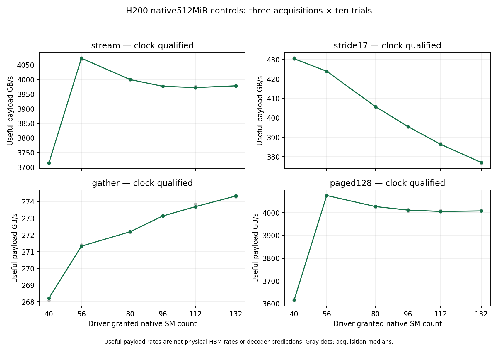

# H200 job16163464: preempted two-device measurement campaign

**The optimized32B B1/C4096 SM sweep did not complete. No NVIDIA5%,10% or25% SM threshold is established.**

Slurm preempted this Embers allocation at 2026-11-26T11:31:51 Eastern after 3633 seconds: **2.0183 allocated GPU-hours**, including staging and idle time. Requested wall time was8hours. The first job exited on signal15; no usable grace interval was demonstrated. Subsequent planning uses actual Slurm deadlines and does not assume extra time from configured grace. See `../environment/final_slurm_accounting.psv`.

## Decoder evidence and affected comparison

Pinned Qwen2.5-32B-Instruct revision `5ede1c97bbab6ce5cda5812749b4c0bdf79b18dd`, BF16/TP1, seed20261013. Optimized and eager C128 controls and optimized B1/C4096 controls matched independent HF dynamic-SDPA references exactly. The unrestricted target proof granted132SMs and mapped all2550 selected decoder kernel launches to the stock context;2499 were graph-node launches. This establishes stock graph execution, not restricted execution.

The full-green optimized proof was interrupted before an allocation record or decoder-placement result. Optimized SM restriction is **unproved**, not demonstrated broken. Restricted eager fallback was not reached. Do not pool these controls with another allocation.

| Device | Unrestricted B1/C4096 raw median wall ms/tick | Timed trials | Clock gate |
|---|---:|---:|---|
| GPU0 `GPU-951a11c2-40ee-3fcb-f71f-49849e744cb1` | 19.2858 | 10 | rejected |
| GPU1 `GPU-b51c6186-ac3b-5149-8b8a-f33943072c47` | 19.3222 | 10 | rejected |

These are one-acquisition observations, not a qualified3-acquisition latency comparison. All trials are retained. The SM clock envelopes failed where marked; memory clocks and exact extrema are in `../results/closeout_summary.json`. No clock or power setting was changed. Primary J/token remains NA. A CPU window audit confirms that all ten GPU0 target trials exceed the5% envelope using interior decode samples alone; prefill is outside the timestamps. See `../results/clock_window_audit_target.json`. The rejection is retained.

## Physical service evidence

GPU1 captured all18 native allocations (six SM counts × three acquisitions), ten conditions each and ten timed trials per condition, with exact known-value checks. **10 of 10 native condition curves pass the complete source/clock envelope across counts.** Native allocations are132/112/96/80/56/40SMs. See `../gpu1/results/native_priority_analysis.json`. The repeatable closeout review now explicitly checks source identity across SM counts as well as within each point. All ten conditions retain qualification; see `../results/native_cross_count_source_audit.json`.



The figure shows useful-payload service, not physical HBM bandwidth, architectural benefit or a decoder threshold. Same-pattern physical counters at every count and3-acquisition counter joins are still missing.

One optimized full-device B1/C4096 application range covering decode ticks4–6 passed replay/output gates. The corrected NCU2026 reader recovers **195243985664 DRAM read bytes and147042560 write bytes** for three generated tokens. The original failed legacy-reader result is preserved; see `../gpu1/results/P2a_graph_b1_c4096_a0_reader_review.json`. Only one of three acquisitions exists; clock/source/clean-timing joins and L2/kernel attribution remain unqualified. No achieved clean GB/s is inferred.

## Paired and native pilots

The synthetic128MiB peer-copy pilot passed. Real HF dynamic-SDPA KV handoff passed for64layers/128BF16 tensors at B1/C128:32MiB logical KV plus an8-byte first token, three warmups and three validation iterations, exact64-token outputs against both source continuation and independent generate. The receiver never prefills. These are functional pilots; vLLM serving connector, loaded serving, physical link bytes and primary transfer latency remain unvalidated. See `../results/P0_real_hf_kv_review.json` and `../results/P0_p2p_review.json`.

## Limitations and resume

Slurm exposed only one CUDA ordinal despite allocating two GPUs. A versioned explicit-UUID repair restored both132-SM H200s; both failed and repaired staging attempts are retained. Driver615.71.09, torch2.11.0+cu130, vLLM0.22.1 and Transformers4.57.6 were verified. The toolkit wrapper selects NCU2026.3.0 on compute and2025.3.1 on login; use a matching report reader and the validated wide/long CSV parser. Startup filesystem I/O delayed inventory. The limitations register retains each discovery and resolution.

GPU1 counter acquisitions1/2 were prepared with a reader-only continuation, but Slurm rejected that step as expired before it ran. No new job was submitted. All P2b/P3/P4 serving, contention and long-context cases remain unmeasured here. Four-GPU comparisons are deferred.

The queue disposition is `../results/case_manifest.json`. Raw artifact hashes are in `../results/checkpoint_raw_inventory.json`; raw profilers remain in persistent workspace and are excluded from public Git. Prior chronological notes are preserved in `report_during_allocation.md`.

The user authorized another two-H200 allocation on November26. The checked resume command is:

```bash
sbatch --parsable batch/h200_priority_resume_20261126.sbatch
```

The resume launcher must obtain a fresh allocation and fresh UUID inventory. Do not reuse expired job16163464 or claim its partial curve complete.

Resume policy: run the target B1/C4096 bounded optimized smoke and exact HF gate before the main sweep; use the spare GPU for missing physical traffic acquisitions before additional native controls. Prior real-KV adapter evidence is reused only as historical software validation; it does not validate handoff on a fresh physical pair.

Follow-up: the authorized replacement job **16184819** was submitted using the command above. See `../../20261125_priority_preparation/results/resubmission_16184819.json`. Its future measurements belong to a fresh allocation and are not pooled into this report.

Source persistence audit: all99 frozen Python sources for each device survive on shared storage and match their hash names (`../results/source_persistence_audit.json`). The legacy process records do not explicitly identify an import-time campaign-driver hash. The next launcher exposes its loaded driver bytes to the existing supervisor snapshot mechanism; no legacy field is fabricated.
