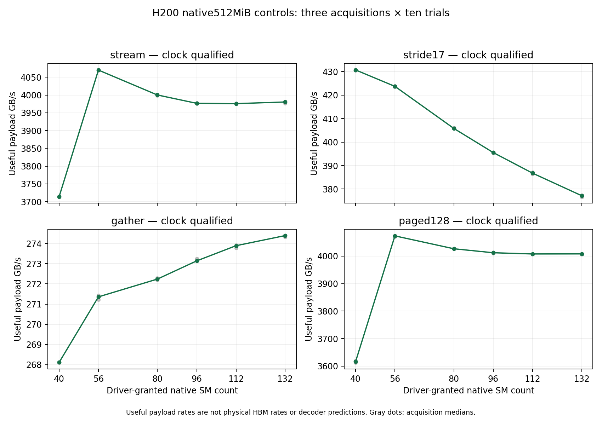

# GPU1 native SM-allocation controls

All ten native condition curves passed source and pooled clock gates across actual132/112/96/80/56/40SM allocations: three independent acquisitions, at least three warmups and ten timed trials per condition (1800 timed observations). Known-value checks and positive SMID observations passed.

These are native patterns, not decoder thresholds or physical HBM service. Useful payload rates do not include measured per-pattern physical DRAM traffic. Physical counter joins at each native SM count remain absent. Different physical GPUs and allocations are not pooled.

Full per-acquisition values, uncertainty intervals, source SHA256s and clock envelopes: `../gpu1/results/native_priority_analysis.json`.
