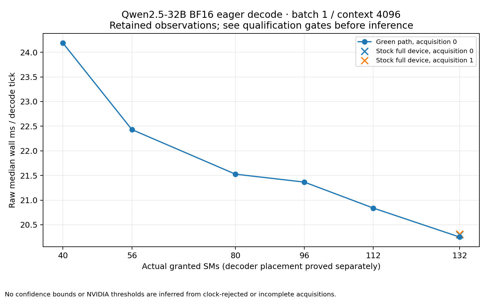

# Two-H200 campaign: job 16210814 closeout

The allocation was preempted on 2026-11-27 at 10:39:07 Eastern, after 3,630 seconds and 2.0167 allocated GPU-hours. This report records partial scientific progress, not a completed campaign. Exact accounting is in [the closeout](allocation_closeout.md).

## First NVIDIA SM curve

Qwen2.5-32B BF16 eager decode, batch 1 / context 4096, completed one whole acquisition at actual Green allocations of 132, 112, 96, 80, 56 and 40 SMs. The unrestricted stock control, full-Green control and interleaved/end full-Green references were captured. Each condition has three warmups and ten timed trials, generating 64 fixed outputs and timing 63 post-barrier decode steps. All actual decoder placement proofs and the independent HF exact-output reference passed.



**Limitations:** acquisition 1 completed only its stock control before preemption interrupted full-Green; acquisition 2 is absent. All captured timing clock envelopes failed. Qualified latency ratios and NVIDIA 5%, 10% and 25% thresholds remain unresolved. The CPU-only process diagnostic during SM80/acquisition0 is an additional isolation caveat, recorded beside that comparison. No trials were removed. See [the GPU0 report](../gpu0/analysis/report.md), [curve JSON](../gpu0/results/curve_eager_b1_c4096.json) and [terminal core disposition](../gpu0/results/eager_core_disposition.json).

The optimized restricted graph path remains blocked by previously measured context escape and a bounded capture/context-stack repair failure. This eager curve is separately labeled and is never normalized to optimized timing.

## Physical traffic and scheduler observation

The separate native-linker repair cohort on GPU1 completed and passed CPU provenance/replay review for all three full optimized B1/C4096 DRAM/L2 acquisitions. Matching raw counter reports, replay publications, source identities and exact output references are retained. L2 is total requested bytes, not a hit rate. There is no qualified clean-bandwidth join, restricted-side explanation, or architectural SRAM-saving claim.

All three independent clean/observed scheduler pairs completed with exact outputs. Each producer has three warmups and ten timed trials. Each observed producer retains 13 scheduler files and 832 step records, verifying one full-prefill step followed by 63 decode-only steps per request without mixed steps or preemption. This completes a functional observer pilot; it does not complete loaded or tuned serving. All six clock gates failed and no observer latency ratio is qualified.

See [the audited comparisons](../gpu1_native_linker/analysis/counter_observer_review.md), [physical provenance](../gpu1_native_linker/results/P2a_L2_triplicate_review.json) and [scheduler provenance](../gpu1_native_linker/results/P3a_observer_review.json). This additional cohort is explicit because the generic allocation closeout discovers only the original gpu0/gpu1 directories. The original failed compiler attempt and all partial GPU0 observer cases remain separate and retained.

## Resume and preservation

No GPU process survives this allocation. Original timing and raw profiler files remain on shared storage. Different UUIDs, source cohorts and protocols are not pooled. The earlier verified native curves and real-KV software validation remain reusable only within their original scopes. A fresh real-KV handoff on this physical pair was deferred.

The owner authorized continued sequential two-H200 submissions. Job **16228671** is queued with a 90-minute limit. Its separately versioned resident eager protocol requires a bounded stock/full-Green/40SM actual-decoder proof and independent HF reference before a full proof and three independent acquisitions. It retains the full model once per acquisition to reduce repeated startup cost; this changes initialization/cache history and will not be pooled with this run. Missing eligible full-GPU context work follows the published core disposition.

The next command is:

```bash
timeout 25s squeue -h -j 16228671 -o '%i|%T|%l|%Q|%M|%R'
```

The chronological allocation report is preserved in [report_during_allocation.md](report_during_allocation.md). The limitations register and per-comparison reports retain failures, attempted remedies and resume conditions.

## Verified backup

The project archive contains all838 inventoried regular files (153,536,865 source bytes); every archived member and the destination checksum were verified. Archive: `/storage/project/r-dmahajan7-0/jkim4112/h200_priority_archives/20261127_job16210814_priority_b15337e1c640.tar.gz`. SHA256: `a1e264980631ab717c8869082beeba47edb82891c592f6d368484e969c87faee`. The [transfer receipt](../results/archive_transfer_b15337e1c640.json) records exact counts and checksums. Original shared-storage data is retained. The receipt and this archive note were created after the archive snapshot and are published separately in Git.

## Later CPU launch-path audit

[The saved eager trace catalog](../../20261127_resident_preparation/analysis/eager_decoder_grid_catalog.md) records an actual attention-output-projection symbol/grid change between112and96SM, under the original frozen source and settings. See the GPU0 report for its interpretive limitation. This CPU follow-up and its notes postdate the verified archive snapshot and are published separately in Git; original raw traces are unchanged.

## Later CPU correctness-scope audit

This allocation's full-length32B C4096 HF reference uses dynamic-cache SDPA. The historical32B StaticCache smoke coversC128; matching C4096 StaticCache agreement is not demonstrated by it. No new StaticCache mismatch is claimed. See `h200/20261127_resident_preparation/results/reference_gate_audit.json` and the limitations register. Existing clock-rejected timings remain unqualified; physical captures keep their recorded dynamic-reference scope. The next versioned reference requires both full-shape cache routes and the exact source checksum. This follow-up note postdates the archived allocation snapshot and adds no GPU measurement.
