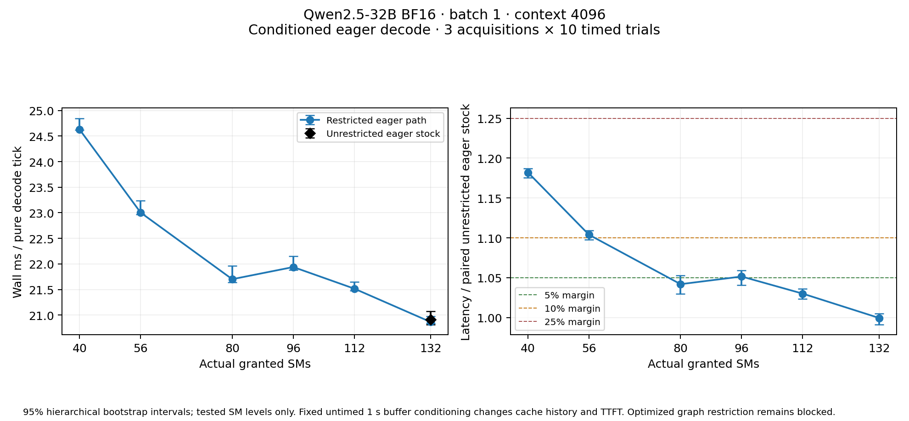

# H200 campaign: complete qualified conditioned eager SM curve

CPU review qualified the complete Qwen2.5-32B BF16 **conditioned eager** B1/context 4096 curve. Three independent processes each captured nine conditions, with three warmups and ten timed trials per condition. All seven real-decoder placement proofs, independent dynamic and unchanged StaticCache references, immutable source/run checksums and isolation checks passed. Every sampled clean SM clock was1980 MHz and memory clock3201 MHz; pooled clock gates passed.

The smallest **tested** counts demonstrated within 5%, 10% and 25% of unrestricted full eager latency, using the paired upper95%confidence bound, are **112, 80 and 40 SMs**, respectively. These NVIDIA thresholds were derived independently of AMD. Counts between tested levels remain unresolved; nonmonotonic points are retained.

**Scope:** one prospectively fixed one-second private-buffer workload follows each verified prefill barrier, outside pure-decode timing. This changes cache history and TTFT. The result does not qualify the original unconditioned workload, optimized graph restriction, deployment benefit, physical area or HBM-capacity savings. Optimized SM restriction remains blocked by the earlier captured graph-context escape and bounded repair failure. The earlier complete unconditioned raw curve remains clock-rejected in its own UUID/source cohort.

## Measured curve

| Path | Actual SMs | Median of acquisition medians, ms/tick | Hierarchical95%CI | Paired latency/stock | Paired95%CI |
|---|---:|---:|---|---:|---|
| unrestricted eager stock | 132 | 20.9098 | [20.8151, 21.0780] | 1 | normalization |
| Green eager | 132 | 20.8656 | [20.8405, 20.9755] | 0.9995 | [0.9912, 1.0050] |
| Green eager | 112 | 21.5171 | [21.4764, 21.6509] | 1.0300 | [1.0232, 1.0363] |
| Green eager | 96 | 21.9397 | [21.8784, 22.1510] | 1.0515 | [1.0406, 1.0594] |
| Green eager | 80 | 21.7021 | [21.6443, 21.9623] | 1.0419 | [1.0297, 1.0528] |
| Green eager | 56 | 23.0040 | [22.9641, 23.2378] | 1.1039 | [1.0976, 1.1090] |
| Green eager | 40 | 24.6278 | [24.6156, 24.8476] | 1.1820 | [1.1753, 1.1867] |

Each request produces 64 fixed greedy outputs. Pure decode starts only after the one-token prefill barrier and times 63 ticks; first-selected-token/prefill, total generated tokens, GPU-event time and synchronized wall time remain separate. Full Green 132-SM references are interleaved and repeated at the end of each acquisition. Bootstrap uses 10,000 draws and seed 20261013. Primary energy remains NA under the existing window/cadence gates.

GPU 0: `GPU-c0239183-b7f8-10aa-11ef-b7e9c10a4235`,132 physical SMs; numerical source `b10d2f7b72147cbcb883ae99b6ba9d49cbf11a6c433080ff53d8070ce72987f7`. The full64-output dynamic and unchanged StaticCache references both passed at context 4096. Decoder placement captures cover ticks 4/5/6, 2553 kernel launches per setting, with no graph kernels and the expected context.

Core evidence: [curve JSON](../gpu0/results/curve_eager_b1_c4096.json), [CPU provenance review](../gpu0/results/resident_curve_CPU_review.json), [raw acquisition medians](../gpu0/analysis/resident_curve_CPU_review.md), [kernel launch catalog](../gpu0/analysis/eager_decoder_grid_catalog.md), [plot receipt](../gpu0/results/eager_qualified_sm_plot.json). Raw counter/SQLite artifacts are inventoried separately and retained.

## Independent GPU 1 context work and thermal limitation

GPU 1 `GPU-77cd4a86-b663-9b1f-80cd-4a0af9be721c` completed all three optimized full-device context-4096 acquisitions and both independent references, but pooled SM-clock ratio3.565217failed the unchanged1.05gate. Its raw timings are descriptive only; no optimized/eager ratio, clean bandwidth or confidence interval is qualified. C16384 completed its full-device kernel proof, both independent references and all three acquisitions with ten timed trials each. Its pooled SM-clock ratio 3.913043 failed the gate; raw medians 35.395486/35.499924/35.805847 ms/tick remain descriptive only. C32704 has not been launched.

The read-only20:28 UTC diagnostic recorded `SwThermalSlowdown` on GPU 1 in25/25 samples at87–88°C and345–855 MHz. GPU 0was32–38°C without that thermal flag. This supports a current thermal limitation, not retrospective proof of every failed clock window. No clock, power, driver, cooling or cluster settings changed. Exact source/raw observations remain in [the diagnostic](../environment/clock_events_20261127T2028.json) and [GPU 1report](../gpu1/analysis/report.md). The queued replacement job excludes this node.

## Continuation

GPU 0has returned after completing and publishing the curve. Its remaining budget is below both full functional-pilot-plus-reference admission estimates, so no additional GPU 0producer was launched; see [budget disposition](../results/postcore_deferred_budget.json). Priority now advances to batch8before batch32and longer restricted curves, with independent prefill work on the spare device.

Owner-authorized replacement **16238357** is PENDING for Priority; its `afterany:16233972` dependency has been satisfied. It requests twoH200s,90minute ceiling and node`atl1-1-02-014-9-0`excluded. It will run the original unconditioned batch8/C4096resident eager protocol with its own placement/reference gates; the spare runs the first1Kwhole/chunk256/1024/4096/whole_end3x10prefill comparison after a fresh functional/dualHFsmoke. A queued case is not evidence. Exact submission/exclusion receipts are in `h200/20261127_resident_preparation/results/submission_16238357*.json`.

P2a prior physical DRAM/L2 triplicates and native service controls remain reusable only in their recorded scopes. Kernel retuning and restricted counter joins, P2bcompetition, loaded/tuned/held-out P3serving and native1P1D, long-prompt/output/serving P4matrix, P5aKV-capacity/deployment and remaining P5ccalibration are unfinished. Four-GPU ratios and optional TP remain deferred beyond the current two-GPU scope. Prospective CPU adapters and code audits are not new GPU results.

Slurm reports **COMPLETED**, exit0:0, from14:45:43to15:43:50Eastern:3487seconds and**1.937222GPU-hours**. The five closed allocations total**9.997778GPU-hours**, including staging, idle and profiling. The complete closed allocation archive is verified (details below). Chronological notes are preserved in [the in-allocation report](report_during_allocation.md); all limitations remain in the central register and affected worker reports.

## Allocation release

Both owned workers returned and their current-process records are idle. No complete additional GPU comparison fits the remaining launch budget. The coordinator finalized gracefully before first-hour preemption eligibility; terminal accounting confirms COMPLETED and the GPU-hours above. The replacement remains dependency-held until this job terminates.

## Queue disposition

- P0: partial; Inventory, sparse and all-level eager kernel proofs, independent dynamic/StaticCache and peer-copy controls recorded; optimized Green graphs and fresh-pair realKVremain separate
- P1a: partial; Complete conditioned eager fallback qualified, thresholds112/80/40SMs; optimized graph restriction remains separately blocked
- P1b: partial; Full optimized B1/C4096andC16384triplicates captured with both HF references, but pooled clocks fail; width8queued separately, width32andlong restricted curves pending
- P2a: pending; Physical traffic captures retain replay/range gates; counter-clock joins and kernel retuning are separate
- P2b: pending; not acquired in this allocation
- P3a: pending; not acquired in this allocation
- P3b: pending; not acquired in this allocation
- P4a: pending; not acquired in this allocation
- P4b: pending; not acquired in this allocation
- P4c: pending; not acquired in this allocation
- P5a: pending; not acquired in this allocation
- P5b: deferred; requires four allocated GPUs
- P5c: pending; not acquired in this allocation
- P5d: pending; not acquired in this allocation

## Terminal provenance and closed evidence backup

Both workers exited0 and no interrupted producers or source/isolation issues were found. The separate GPU 1 CPU review validates both optimized context triplicates while retaining their failed clock gates. Generic terminal statistics matched the original qualified conditioned curve exactly; the canonical annotated curve was restored byte-identically from its verified closed-unit backup and all27original raw-run, session and HF checksums reverified. See [terminal reconciliation](../results/terminal_evidence_reconciliation.json) and [allocation accounting](../results/allocation_closeout.json).

The closed GPU 0 unit contains344files /51,046,840source bytes. Its verified project archive is `/storage/project/r-dmahajan7-0/jkim4112/h200_priority_archives/gpu0_3cd84b58768a.tar.gz`, SHA256`13d54219fc631f015b236b9fdd70b562878ee043dd0e15e586c3757abe1dccf2`. Every member and the destination readback were verified. This earlier backup predates terminal CPU reconciliation notes; raw NUM evidence is unchanged. All six Green launch-signature sets are identical in the current saved proof ranges, which does not substitute for a kernel-retuning or causal explanation.

## Whole-allocation archive verification

All 665 files / 84,357,992 source bytes were archived to `/storage/project/r-dmahajan7-0/jkim4112/h200_priority_archives/20261127_job16233972_priority_438b3c019c21.tar.gz` (12,239,786 bytes compressed). SHA256: `243f4481a13abb28e3aa22344d3caacab2be95a8800dfccbd68bd9cf45da9a5b`. Every member and destination readback passed. [Transfer receipt](../results/archive_transfer_438b3c019c21.json). This final transfer-receipt paragraph and status metadata postdate the archive; the closed NUM data, scientific reviews, plots and accounting were included. Original raw files remain in the workspace.
